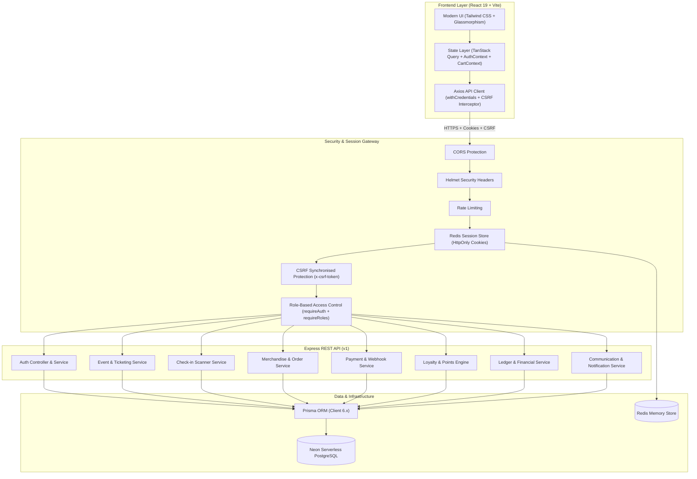
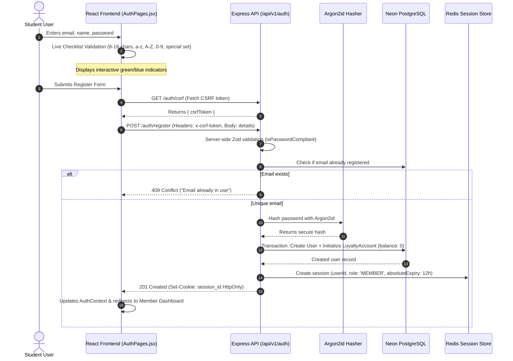
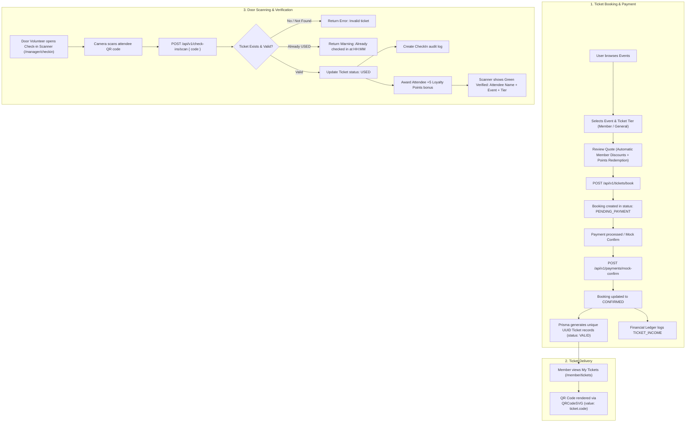
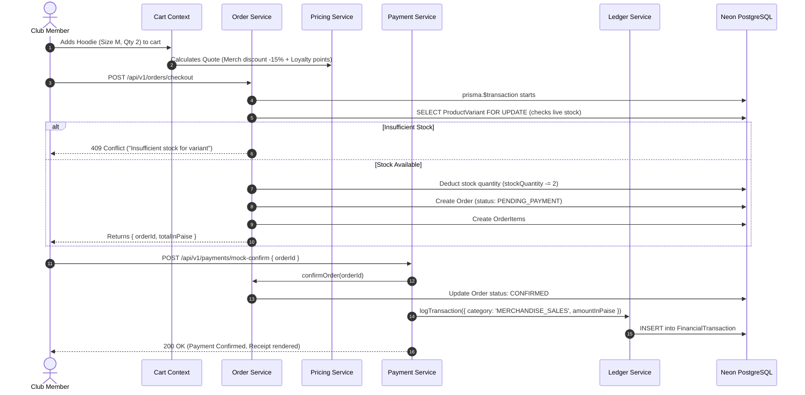
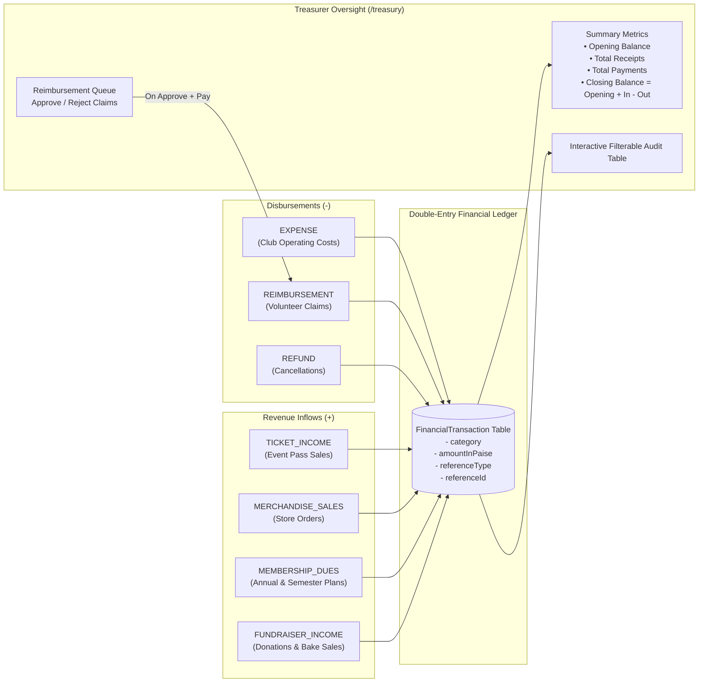
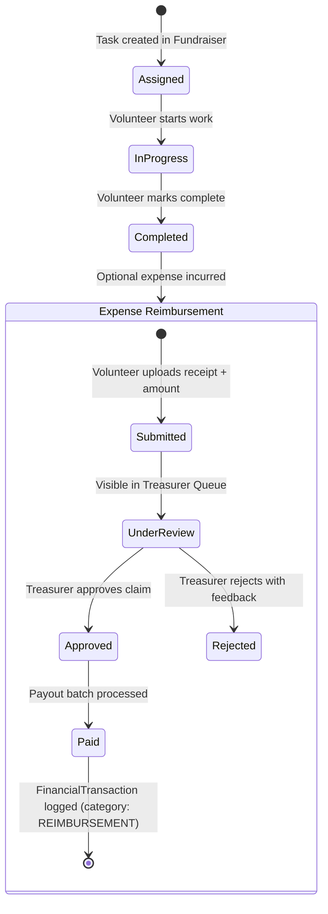

# Student Organization System (SOS)

## Complete Architecture & Operational Flowcharts

This document provides a deep, comprehensive breakdown of how the Student Organization System works end-to-end, detailing every architectural layer, database model, security control, and business workflow accompanied by Mermaid flowcharts.

---

## 1. High-Level System Architecture



---

## 2. Authentication & User Onboarding Flow

### 5-Point Strict Password Validation & Registration

Every new student account must fulfill 5 cryptographic password requirements before account creation:

1. **Length**: 8 to 16 characters inclusive.
2. **Lowercase letter**: `[a-z]`
3. **Uppercase letter**: `[A-Z]`
4. **Numeric character**: `[0-9]`
5. **Special character**: Exactly from `$ @ # % ^ & * ? - + =`



---

## 3. Event Ticketing & QR Code Check-in Flow



---

## 4. Merchandise Store, Inventory & Ledger Flow

Merchandise orders enforce atomic transaction safety so stock quantities never oversell:



---

## 5. Treasury & Financial Transparency Flow

Every rupee received or disbursed is immutably logged into the financial ledger with automated categorizations:



---

## 6. Volunteer Kanban & Reimbursement Workflow



---

## 7. Role-Based Access Control (RBAC) Matrix

| Route Group     | Path                                         | Minimum Required Role          | Purpose                                           |
| :-------------- | :------------------------------------------- | :----------------------------- | :------------------------------------------------ |
| **Public**      | `/api/v1/events`                             | Any / Guest                    | Browse calendar and ticket pricing                |
| **Public**      | `/api/v1/products`                           | Any / Guest                    | Browse merchandise catalog and variants           |
| **Public**      | `/api/v1/communication/announcements`        | Any / Guest                    | View published club announcements                 |
| **Auth**        | `/api/v1/auth/register`, `/login`            | Public                         | Account registration & session authentication     |
| **Member**      | `/api/v1/tickets/me`                         | `MEMBER`                       | View user's tickets and QR codes                  |
| **Member**      | `/api/v1/orders/me`                          | `MEMBER`                       | View order history and delivery statuses          |
| **Member**      | `/api/v1/memberships/me`                     | `MEMBER`                       | View active plan status, renewal, tier perks      |
| **Member**      | `/api/v1/loyalty/me`                         | `MEMBER`                       | View points balance, earned, and transaction logs |
| **Volunteer**   | `/api/v1/fundraisers`                        | `VOLUNTEER`                    | View tasks, change status (todo -> doing -> done) |
| **Volunteer**   | `/api/v1/expenses`                           | `VOLUNTEER`                    | Submit receipt claims for tasks                   |
| **Check-in**    | `/api/v1/check-ins/scan`                     | `EVENT_MANAGER` / `CLUB_ADMIN` | Scan attendee QR codes at event entry             |
| **Treasury**    | `/api/v1/ledger`                             | `TREASURER` / `CLUB_ADMIN`     | View financial records and club balance           |
| **Treasury**    | `/api/v1/expenses/:id/review`                | `TREASURER` / `CLUB_ADMIN`     | Approve or reject volunteer reimbursements        |
| **Admin**       | `/api/v1/events` (POST)                      | `CLUB_ADMIN` / `EVENT_MANAGER` | Create new events and ticket tiers                |
| **Admin**       | `/api/v1/communication/announcements` (POST) | `CLUB_ADMIN`                   | Publish broadcast announcements to members        |
| **Super Admin** | `/api/v1/health/detailed`                    | `SUPER_ADMIN`                  | Real-time system health, database & redis status  |

---

## 8. Development & Production Operations

### Commands Summary

```bash
# Start backend server
npm run dev

# Start frontend application (Vite)
npm run frontend:dev

# Build frontend production bundle
npm run frontend:build

# Run complete Vitest suite (9 test suites, 26 integration tests)
npm test

# Check code formatting (Prettier)
npm run format:check

# Format code automatically (Prettier)
npm run format

# Run linter (ESLint)
npm run lint

# Seed database with demo accounts, events, and merchandise
npm run db:seed
```
